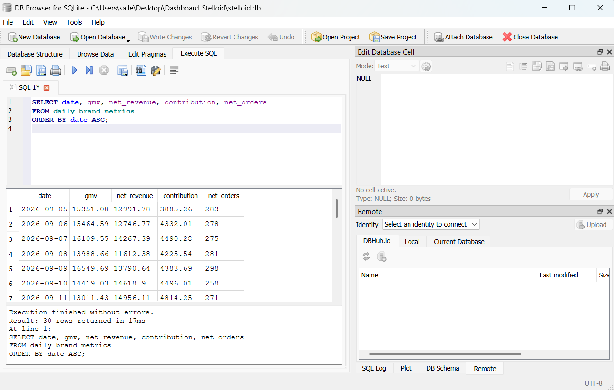
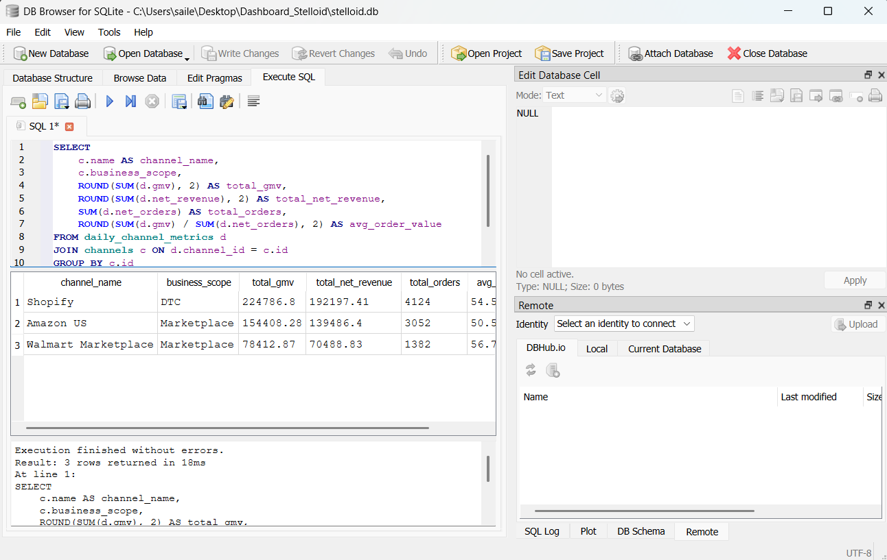
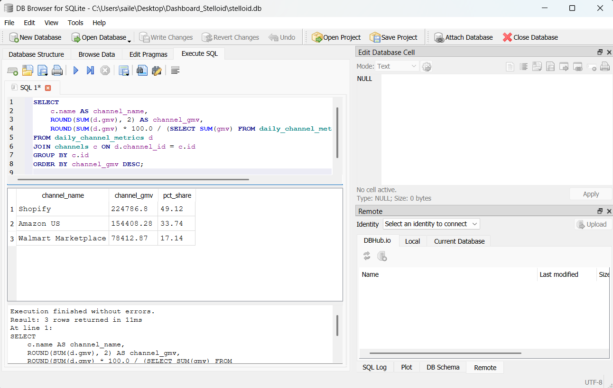

# Stelloid Command Center Dashboard API

[](https://fastapi.tiangolo.com)
[](https://www.python.org/)
[](https://www.sqlite.org/)
[](https://www.docker.com/)
[](https://docs.pytest.org/)

A production-ready **FastAPI** backend analytics service designed to power the **Stelloid Command Center Dashboard**. It provisions a normalized SQLite relational data store, seeds deterministic multi-channel e-commerce time-series data, exposes high-performance RESTful endpoints with filtering, caching, and pagination, and includes an interactive embedded web frontend.

---

## Table of Contents
- [Project Overview](#project-overview)
- [Dashboard Concepts](#dashboard-concepts)
- [Architecture & Tech Stack](#architecture--tech-stack)
- [Database Schema & Data Model](#database-schema--data-model)
- [Database Verification & Screenshots](#database-verification--screenshots)
- [Deterministic Data Seeding](#deterministic-data-seeding)
- [Quick Start & Local Setup](#quick-start--local-setup)
- [Docker & Containerized Deployment](#docker--containerized-deployment)
- [API Reference & Documentation](#api-reference--documentation)
- [Stretch Goals Implemented](#stretch-goals-implemented)
- [Automated Testing](#automated-testing)
- [Project Structure](#project-structure)
- [Confidentiality & Compliance](#confidentiality--compliance)

---

## Project Overview

- **Task**: Backend Engineering Task — Stelloid Command Center Dashboard API
- **Owner**: Pushpendra Jaiswal
- **Assignee**: Shailesh
- **Due Date**: 14 October 2026

The backend provides aggregated and time-series analytics across omnichannel sales operations (Direct-to-Consumer and Online Marketplaces). It delivers reliable JSON payloads for executive KPI cards, daily revenue and contribution margins, market share distribution charts, and granular channel-level economics.

---

## Dashboard Concepts

The API is specifically structured to support all analytics modules required for the Stelloid Command Center interface:

1. **Brand Overview Cards**: High-level brand summary for GMV, Net Revenue, Contribution Margin, Returns/Refunds, Net Orders, and Average Order Value (AOV).
2. **Revenue & Contribution Trend**: Continuous time-series charting daily net revenue and contribution.
3. **Channel Distribution**: Comparative breakdowns across sales channels (`Shopify`, `Amazon US`, `Walmart Marketplace`) for any selected measure.
4. **Channel Performance Table**: Deep-dive channel economics with order volume and average order values.
5. **Interactive Controls**: Date-range filtering, channel selection, and business scope segregation (`DTC` vs. `Marketplace`).

---

## Architecture & Tech Stack

- **Web Framework**: [FastAPI](https://fastapi.tiangolo.com) (Python 3.10+)
- **ORM & Data Layer**: [SQLAlchemy 2.0](https://www.sqlalchemy.org/)
- **Database**: SQLite 3 (stored at `./stelloid.db`)
- **Schema Validation**: [Pydantic v2](https://docs.pydantic.dev/)
- **Testing**: [pytest](https://pytest.org) + `httpx` (`TestClient`)
- **Containerization**: Docker & Docker Compose
- **Interactive API Docs**: Swagger UI (`/docs`) & ReDoc (`/redoc`)
- **Embedded Frontend**: Served statically at `/` via FastAPI `StaticFiles`

---

## Database Schema & Data Model

The application uses a normalized relational schema designed for efficient aggregation and time-series slicing:

```
┌─────────────────────────┐
│        channels         │
├─────────────────────────┤
│ id (PK, Integer)        │◀────┐
│ name (String, Unique)   │     │
│ business_scope (String) │     │
└─────────────────────────┘     │
                                │ 1:N
┌──────────────────────────────────────┐     │
│        daily_channel_metrics         │     │
├──────────────────────────────────────┤     │
│ id (PK, Integer)                     │     │
│ date (Date, Indexed)                 │     │
│ channel_id (FK -> channels.id)       │─────┘
│ gmv (Float)                          │
│ net_revenue (Float)                  │
│ contribution (Float)                 │
│ returns_refunds (Float)              │
│ net_orders (Integer)                 │
└──────────────────────────────────────┘

┌──────────────────────────────────────┐
│         daily_brand_metrics          │
├──────────────────────────────────────┤
│ id (PK, Integer)                     │
│ date (Date, Unique, Indexed)         │
│ gmv (Float)                          │
│ net_revenue (Float)                  │
│ contribution (Float)                 │
│ returns_refunds (Float)              │
│ net_orders (Integer)                 │
└──────────────────────────────────────┘
```

### Table Definitions

1. **`channels`**: Available sales channels.
   - `id`: Primary Key
   - `name`: Sales channel name (e.g. `Shopify`, `Amazon US`, `Walmart Marketplace`).
   - `business_scope`: Operating scope (`DTC` or `Marketplace`).

2. **`daily_channel_metrics`**: Granular daily performance records per channel.
   - Supports date filtering, channel slicing, and dynamic aggregations across arbitrary reporting periods.

3. **`daily_brand_metrics`**: Pre-aggregated brand-level daily totals.
   - Accelerates global overview queries and unfiltered brand-level trend charts.

---

## Database Verification & Screenshots

The database state and aggregations have been verified using **DB Browser for SQLite**:

### 1. Daily Brand Metrics (`daily_brand_metrics`)
Demonstrates continuous daily aggregated totals across the 30-day reporting window (`2026-09-05` to `2026-10-04`).

```sql
SELECT date, gmv, net_revenue, contribution, net_orders
FROM daily_brand_metrics
ORDER BY date ASC;
```



---

### 2. Channel Performance Aggregation (`daily_channel_metrics` JOIN `channels`)
Demonstrates the exact multi-metric calculation (GMV, Net Revenue, Orders, and calculated Average Order Value) per channel over the 30-day period.

```sql
SELECT
    c.name AS channel_name,
    c.business_scope,
    ROUND(SUM(d.gmv), 2) AS total_gmv,
    ROUND(SUM(d.net_revenue), 2) AS total_net_revenue,
    SUM(d.net_orders) AS total_orders,
    ROUND(SUM(d.gmv) / SUM(d.net_orders), 2) AS avg_order_value
FROM daily_channel_metrics d
JOIN channels c ON d.channel_id = c.id
GROUP BY c.id;
```



---

### 3. Channel Distribution & Percentage Share (`daily_channel_metrics`)
Demonstrates revenue contribution and relative market share percentages across all channels.

```sql
SELECT
    c.name AS channel_name,
    ROUND(SUM(d.gmv), 2) AS channel_gmv,
    ROUND(SUM(d.gmv) * 100.0 / (SELECT SUM(gmv) FROM daily_channel_metrics), 2) AS pct_share
FROM daily_channel_metrics d
JOIN channels c ON d.channel_id = c.id
GROUP BY c.id
ORDER BY channel_gmv DESC;
```



---

## Deterministic Data Seeding

The synthetic dataset is generated by [app/seed.py](app/seed.py) using a fixed pseudo-random seed (`RANDOM_SEED = 42`). 

- **Reproducibility**: Running the seed script produces the exact same records every time.
- **Tuned Realism**: Baselines are calibrated so that 30-day aggregate totals align closely with the reference dashboard:
  - **GMV**: ~$446,792
  - **Net Revenue**: ~$404,360
  - **Contribution**: ~$134,289
  - **Returns & Refunds**: ~$20,695
  - **Net Orders**: ~8,604
  - **Average Order Value (AOV)**: ~$47.00
- **Time Range**: 30 consecutive calendar days (`2026-09-05` through `2026-10-04`).

To rebuild the database at any time:
```bash
python -m app.seed
```

---

## Quick Start & Local Setup

### 1. Prerequisites
- Python 3.10 or higher
- `pip` package manager

### 2. Clone and Setup Environment
```bash
git clone https://github.com/sailesh3010/Dashboard_Stelloid.git
cd Dashboard_Stelloid

# Create virtual environment
python -m venv venv

# Activate virtual environment
# Windows (PowerShell):
.\venv\Scripts\Activate.ps1
# Windows (CMD):
venv\Scripts\activate.bat
# Linux / macOS:
source venv/bin/activate
```

### 3. Install Dependencies
```bash
pip install -r requirements.txt
```

### 4. Seed Mock Database
```bash
python -m app.seed
```
*Creates `stelloid.db` with channels, daily channel metrics, and daily brand totals.*

### 5. Launch API Server
```bash
uvicorn app.main:app --reload --port 8000
```

- **Interactive Dashboard UI**: [`http://localhost:8000/`](http://localhost:8000/)
- **Swagger UI (Interactive Docs)**: [`http://localhost:8000/docs`](http://localhost:8000/docs)
- **ReDoc Documentation**: [`http://localhost:8000/redoc`](http://localhost:8000/redoc)
- **Health Check**: [`http://localhost:8000/health`](http://localhost:8000/health)

---

## Docker & Containerized Deployment

A multi-stage [Dockerfile](Dockerfile) and [docker-compose.yml](docker-compose.yml) are provided for zero-dependency container execution.

### Build and Run with Docker Compose
```bash
docker compose up --build
```

The service will be accessible on port `8000`:
- Dashboard: `http://localhost:8000`
- Swagger UI: `http://localhost:8000/docs`

The container configuration includes:
- Python 3.11-slim base image
- Automated database seeding during container build
- Persistent host volume mounting for `./stelloid.db`
- `restart: unless-stopped` policy

---

## API Reference & Documentation

All core analytics endpoints are mounted under the `/api/v1` prefix.

### Query Parameters Supported Across Endpoints

| Parameter | Type | Required | Description |
| :--- | :---: | :---: | :--- |
| `start_date` | `date` (`YYYY-MM-DD`) | No | Filter start date (defaults to earliest date) |
| `end_date` | `date` (`YYYY-MM-DD`) | No | Filter end date (defaults to latest date) |
| `channel` | `string` | No | Filter by channel name (e.g., `Shopify`, `Amazon US`) |
| `business_scope`| `string` | No | Filter by business scope (`DTC` or `Marketplace`) |
| `metric` | `string` | No | Metric selector for distribution (`gmv`, `net_revenue`, etc.) |
| `limit` | `integer` (1-100) | No | Maximum items to return for paginated endpoints |
| `offset` | `integer` (>= 0) | No | Number of records to skip for pagination |

---

### Endpoints

#### 1. `GET /health`
Returns service availability status.
```json
{
  "status": "healthy"
}
```

#### 2. `GET /api/v1/channels`
Retrieves all configured sales channels and their scopes.
```json
[
  {"id": 1, "name": "Shopify", "business_scope": "DTC"},
  {"id": 2, "name": "Amazon US", "business_scope": "Marketplace"},
  {"id": 3, "name": "Walmart Marketplace", "business_scope": "Marketplace"}
]
```

#### 3. `GET /api/v1/overview`
Aggregated brand summary metrics for the selected reporting period.
```http
GET /api/v1/overview?start_date=2026-09-05&end_date=2026-10-04
```
**Response (200 OK):**
```json
{
  "date_range": {
    "start": "2026-09-05",
    "end": "2026-10-04"
  },
  "overview": {
    "gmv": 446792.5,
    "net_revenue": 404360.2,
    "contribution": 134289.1,
    "returns_refunds": 20695.3,
    "net_orders": 8604,
    "average_order_value": 51.93
  }
}
```

#### 4. `GET /api/v1/trends`
Daily time-series trend of net revenue and contribution margin.
```http
GET /api/v1/trends?start_date=2026-09-05&end_date=2026-09-07
```
**Response (200 OK):**
```json
{
  "date_range": {
    "start": "2026-09-05",
    "end": "2026-09-07"
  },
  "trends": [
    {"date": "2026-09-05", "net_revenue": 12991.78, "contribution": 3885.26},
    {"date": "2026-09-06", "net_revenue": 12746.77, "contribution": 4332.01},
    {"date": "2026-09-07", "net_revenue": 14267.39, "contribution": 4490.28}
  ]
}
```

#### 5. `GET /api/v1/channel-distribution`
Channel contribution for a given metric (`gmv`, `net_revenue`, `contribution`, `returns_refunds`, `net_orders`).
```http
GET /api/v1/channel-distribution?metric=net_revenue
```
**Response (200 OK):**
```json
{
  "date_range": {
    "start": "2026-09-05",
    "end": "2026-10-04"
  },
  "metric": "net_revenue",
  "distribution": [
    {"channel": "Shopify", "value": 192197.41},
    {"channel": "Amazon US", "value": 139486.4},
    {"channel": "Walmart Marketplace", "value": 70488.83}
  ]
}
```

#### 6. `GET /api/v1/channel-performance`
Granular economics and order KPIs per sales channel with pagination support.
```http
GET /api/v1/channel-performance?limit=2&offset=0
```
**Response (200 OK):**
```json
{
  "date_range": {
    "start": "2026-09-05",
    "end": "2026-10-04"
  },
  "total_count": 3,
  "channels": [
    {
      "channel": "Shopify",
      "gmv": 224786.8,
      "net_revenue": 192197.41,
      "contribution": 64890.1,
      "returns_refunds": 9620.4,
      "net_orders": 4124,
      "average_order_value": 54.51
    },
    {
      "channel": "Amazon US",
      "gmv": 154408.28,
      "net_revenue": 139486.4,
      "contribution": 43980.2,
      "returns_refunds": 7560.1,
      "net_orders": 3052,
      "average_order_value": 50.59
    }
  ]
}
```

### Error Responses
All endpoints implement standard HTTP status codes and structured error payloads:
- **`400 Bad Request`**: When `start_date > end_date` or when an invalid distribution metric is requested.
  ```json
  {"detail": "start_date must be on or before end_date."}
  ```
- **`404 Not Found`**: When no matching records exist for the given filter combination.
  ```json
  {"detail": "No channel performance data found for the specified filters."}
  ```

---

## Stretch Goals Implemented

| Goal | Description & Implementation |
| :--- | :--- |
| **Swagger / OpenAPI Documentation** | Interactive Swagger UI at `/docs` with detailed Pydantic `json_schema_extra` examples for all responses and parameters. |
| **Docker Compose Setup** | Containerized deployment with volume persistence in `docker-compose.yml` and `Dockerfile`. |
| **Pagination** | `limit` and `offset` query parameters with `total_count` on `/api/v1/channel-performance`. |
| **HTTP Caching** | Middleware attaches `Cache-Control: public, max-age=60` headers to all GET analytics endpoints. |
| **Health Check Endpoint** | Dedicated `GET /health` endpoint returning `{"status": "healthy"}`. |
| **Deterministic Data Seeder** | Fixed random seed (`42`) produces an identical dataset across all executions and builds. |

---

## Automated Testing

The project includes an automated test suite containing **23 comprehensive test cases** testing all endpoints, filters, pagination, caching headers, and validation edge cases.

### Run Tests
```bash
python -m pytest tests/ -v
```

### Test Coverage Highlights
- `TestHealthCheck`: Validates `GET /health`.
- `TestChannels`: Validates channel listings and scopes.
- `TestOverview`: Validates default overview, date-range filtering, channel filtering, business scope filtering, and date range error handling.
- `TestTrends`: Validates time-series structure, date ordering, and channel filters.
- `TestChannelDistribution`: Validates default and custom metrics, invalid metric handling, and descending sort order.
- `TestChannelPerformance`: Validates channel-level metrics, AOV mathematical consistency (`GMV / Net Orders`), pagination (`limit` & `offset`), and HTTP `Cache-Control` response headers.
- `TestInvalidRequests`: Validates invalid date formats, non-existent channel names, future date ranges, and non-existent routes.

---

## Project Structure

```
Dashboard_Stelloid/
├── app/
│   ├── __init__.py
│   ├── database.py                 # SQLAlchemy engine, session & get_db dependency
│   ├── main.py                     # FastAPI app, middleware, CORS, static frontend mount
│   ├── models.py                   # SQLAlchemy ORM models (Channel, Daily metrics)
│   ├── schemas.py                  # Pydantic v2 schemas with rich documentation examples
│   ├── seed.py                     # Deterministic mock data seeder (fixed seed 42)
│   └── routers/
│       ├── __init__.py
│       ├── channels.py             # GET /api/v1/channels
│       ├── overview.py             # GET /api/v1/overview
│       ├── trends.py               # GET /api/v1/trends
│       ├── channel_distribution.py # GET /api/v1/channel-distribution
│       └── channel_performance.py  # GET /api/v1/channel-performance (paginated)
├── frontend/                       # Interactive dashboard frontend
│   ├── app.js
│   ├── index.html
│   └── styles.css
├── screenshots/                    # Verification database query screenshots
│   ├── db_daily_brand_metrics.png  # DB Browser verification: daily_brand_metrics
│   ├── db_channel_performance.png  # DB Browser verification: channel performance aggregation
│   └── db_channel_distribution.png # DB Browser verification: market share distribution
├── tests/
│   ├── __init__.py
│   ├── conftest.py                 # Test fixtures and SQLite test database setup
│   └── test_api.py                 # 23 automated integration and unit tests
├── .gitignore                      # Git ignore rules for Python, IDE, and test artifacts
├── docker-compose.yml              # Multi-container orchestration config
├── Dockerfile                      # Production container build definition
├── README.md                       # Complete project documentation
├── requirements.txt                # Python package dependencies
└── stelloid.db                     # Seeded SQLite database
```

---

## Confidentiality & Compliance

This repository was developed in accordance with the task confidentiality requirements:
- Only synthetic mock data is utilized. No customer, transaction, or proprietary credentials are included.
- No secrets or access keys are committed to source control.
